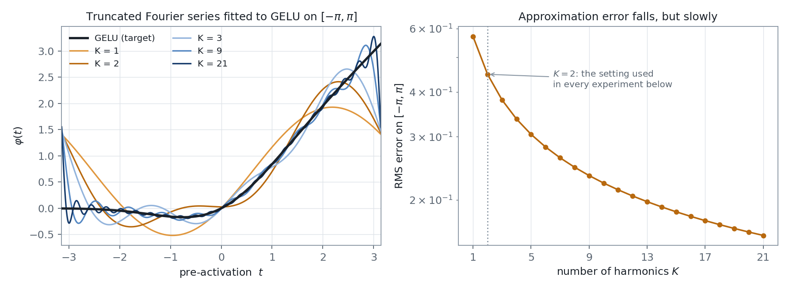
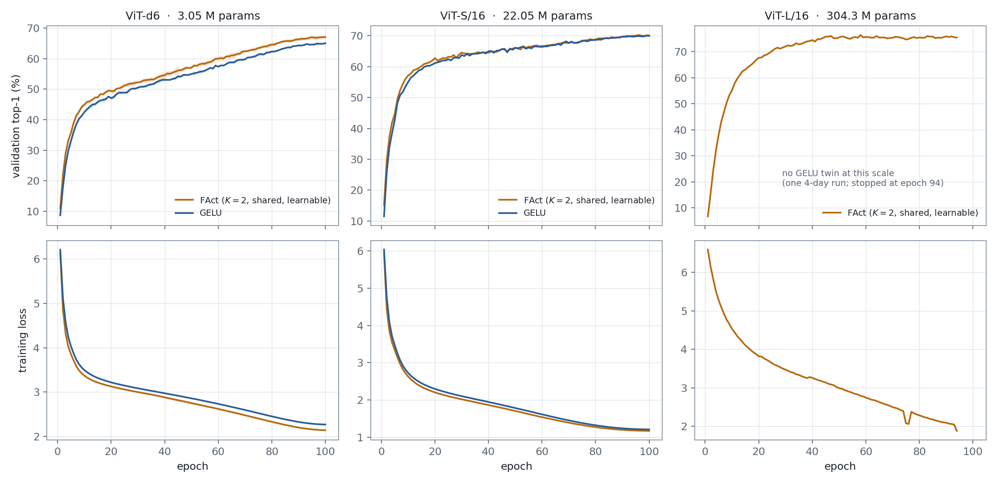
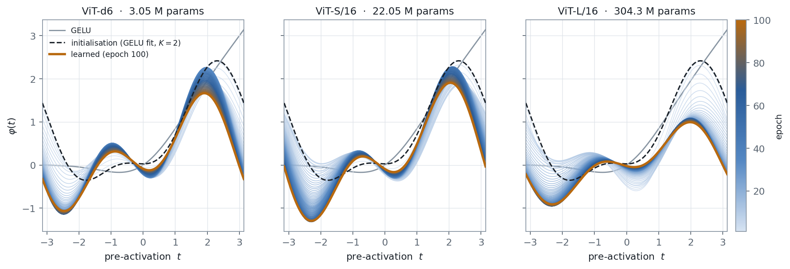
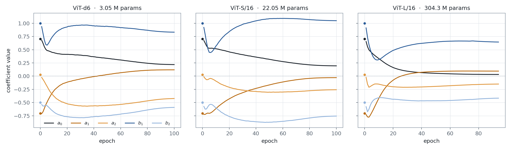
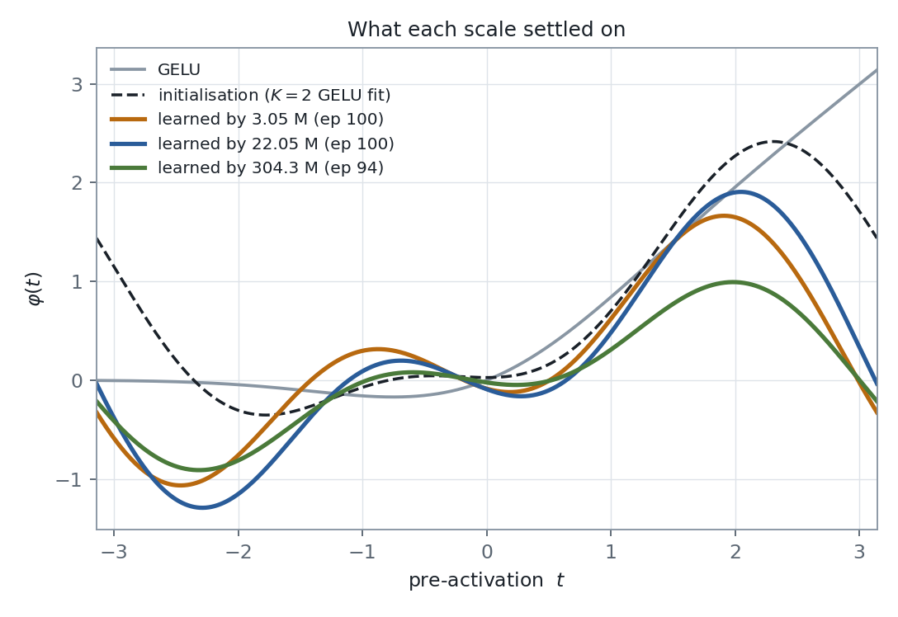

Nearly every architecture we build begins with a decision that is almost never
revisited: which nonlinearity to use. ReLU, GELU, SiLU — the choice is made once,
hard-coded, and then left alone while hundreds of millions of other parameters are
fitted to the data. It is a curious asymmetry. We are willing to learn every weight
and every normalisation statistic, but the one function that makes the network
nonlinear at all is treated as a constant of nature.

This post is about what happens when you stop treating it that way. The construction
is called **FAct**, short for *Fourier Activation*: the nonlinearity is written as a
truncated Fourier series, its coefficients are made learnable, and — this is the part
that matters — the *same* series is shared by every block in the network, so the whole
activation costs five numbers rather than five numbers per neuron.

<!--more-->

*The approximation section below carries an interactive applet. It is also available
as a [standalone page](/visualizations/FAct-Fourier-Activation/gelu-fourier-approximation.html)
if you would like a larger view.*

## Introduction

Write the activation as

$$\varphi(t) \;=\; a_0 \;+\; \sum_{k=1}^{K}\Big[a_k\cos(k\omega t) + b_k\sin(k\omega t)\Big]$$

with $K$ harmonics and a base frequency $\omega$. The $1+2K$ coefficients
$\{a_0, a_k, b_k\}$ are ordinary learnable parameters, updated by the same optimiser
that updates the attention projections. Throughout this post $K=2$ and $\omega=1$, so
the activation is exactly **five scalars**, and $\omega$ is held fixed rather than
learned.

Two design choices deserve to be stated plainly, because they are what make the idea
worth examining at all.

**The series is shared globally.** One `FourierActivation` module is constructed once
and handed by reference to every transformer block. A depth-24 ViT-L therefore does
not have twenty-four activations; it has one, applied in twenty-four places. The
parameter overhead of FAct over a plain GELU network is consequently *exactly five
parameters*, at every scale in this post — 3,048,237 against 3,048,232 at the small
end, and 22,050,669 against 22,050,664 in the middle. Whatever we observe, it cannot
be attributed to extra capacity.

**The coefficients are not initialised randomly.** They are initialised to the true
Fourier coefficients of GELU, computed by numerical integration of the Euler formulas
over the interval $[-\pi/\omega,\,\pi/\omega]$. At $K=2$, $\omega=1$ these work out to

$$(a_0,\,a_1,\,a_2,\,b_1,\,b_2) \;=\; (0.7061,\;-0.7049,\;0.0261,\;1.0000,\;-0.5000)$$

so the network begins life as an approximate GELU network and is then free to move. The
interesting question is not whether it *can* move, but whether it *does*, in which
direction, and whether different models shown the same data agree about where to go.

## Approximation of GELU

Before looking at any training run, it is worth developing some intuition for the
approximation itself, since it is the starting point of every experiment that follows.

Two knobs control the quality of the fit. The first, $K$, is simply how many harmonics
one keeps. The second, $\omega$, is less obvious: it fixes the half-width of the
fitting window, $L = \pi/\omega$. Lowering $\omega$ widens the interval over which the
series is asked to agree with GELU, so the same $K$ harmonics must cover more ground
and the fit inside any fixed band necessarily becomes coarser.

It is worth spending a minute with the applet below. Drag $K$ from 1 to 21, then pull
$\omega$ down towards 0, and watch both the shaded fitting window and the coefficient
table respond.

<iframe id="fact-applet"
        src="/visualizations/FAct-Fourier-Activation/gelu-fourier-approximation.html"
        style="width:100%; height:1400px; border:1px solid #dee3e9; border-radius:10px; background:#F4F6F9;"
        loading="lazy"
        title="Interactive: approximating GELU with a truncated Fourier series"></iframe>
<script>
window.addEventListener("message", function (e) {
  var h = e && e.data && e.data.factAppletHeight;
  var f = document.getElementById("fact-applet");
  if (!f || typeof h !== "number" || h < 400 || h > 4000) { return; }
  var want = h + 4;
  if (Math.abs(parseInt(f.style.height, 10) - want) < 6) { return; }
  f.style.height = want + "px";
});
</script>

Three things tend to stand out.

The first is that **$K=2$ is a poor approximation of GELU, and deliberately so.** Its
RMS error over $[-\pi,\pi]$ is about $0.45$, and even over the narrower band
$[-2,2]$ — where the bulk of the pre-activations actually live — it is around $0.18$.
Five parameters cannot reproduce GELU. They can only start near it.

The second is that **adding harmonics helps far less than one would expect.** Going
from $K=2$ to $K=21$ — from five parameters to forty-three — reduces the RMS error
on the fitting window merely from $0.45$ to $0.16$. The reason is visible in the
plot: the series is periodic, GELU is not, and so there is an unavoidable jump between
$\varphi(-L)$ and $\varphi(L)$. The resulting ringing at the two ends is the Gibbs
phenomenon, and additional harmonics narrow it without reducing its height.

The third is that **$\omega$ trades range against resolution.** At $\omega = 1$ the
window is $[-\pi,\pi]$ and the fit is tolerable in the centre. At $\omega = 0.25$ the
window stretches to $[-12.57, 12.57]$, the sine amplitudes grow roughly as $1/\omega$,
and two harmonics are left tracking GELU over four times the range.



For the experiments that follow, the important consequence is this. A $K=2$ FAct
network does not start as a GELU network. It starts as a crude caricature of one, and
any accuracy it eventually earns must come from the five coefficients finding a better
place to sit — not from a faithful reproduction of GELU.

## Training on ViT

I trained three Vision Transformers on ImageNet-1K, spanning two orders of magnitude
in size, with the globally shared $K=2$ FAct in place of GELU in every FFN. At the two
smaller scales a GELU-activated twin was trained under an identical configuration, so
the activation is the only difference between the arms.

### Training details

| | **ViT-d6** | **ViT-S/16** | **ViT-L/16** |
|---|---|---|---|
| Parameters (FAct / GELU) | 3,048,237 / 3,048,232 | 22,050,669 / 22,050,664 | 304,326,637 / — |
| Depth · embed · heads | 6 · 192 · 6 | 12 · 384 · 6 | 24 · 1024 · 16 |
| Patch · resolution | 16 · 224² | 16 · 224² | 16 · 224² |
| Optimiser | AdamW | AdamW | AdamW |
| Base learning rate | 1e-3 | 1e-3 | 1e-4 |
| Weight decay | 0.05 | 0.05 | 0.05 |
| Warm-up / schedule | 5 ep · cosine | 5 ep · cosine | 2 ep · cosine |
| Batch size | 256 | 512 | 64 |
| Epochs | 100 | 100 | 100 scheduled, stopped at 94 |
| Augmentation | RRC(0.5–1.0) + flip | RRC(0.5–1.0) + flip | heavy: RandAugment(2,9) + RandomErasing(0.25) + RRC(0.08–1.0) + mixup 0.8 / CutMix 1.0 |
| Seeds | 3 | 1 | 1 |
| Wall-clock (per run)† | ≈ 19–27 h | ≈ 43 h | ≈ 3.7 days |

† Wall-clock is quoted only to convey the scale of each run. These were shared
machines with varying contention, so the figures are not a like-for-like timing
comparison between the arms.

Common to all three: dropout 0.1, label smoothing 0.1, MLP ratio 4.0, cosine schedule
with linear warm-up, and FAct initialised from the GELU fit with $\omega$ frozen at 1.
The data split is also common: 1,271,167 training images with 10,000 held out from the
training set as the validation split, and the official 50,000-image ImageNet validation
set used strictly as a held-out test set. Every accuracy reported as "test" below is
measured on those 50,000 images.

One caveat must be registered at the outset, since it governs how much the three rows
may be compared with each other. **This is not a controlled scaling study.** The ViT-L
run differs from the two smaller runs in learning rate, batch size and augmentation
recipe, all of which were chosen to make a 304M model trainable from scratch within a
reasonable wall-clock budget rather than to hold the comparison fixed. It also has no
GELU twin — a second four-day run was not affordable. The ViT-L row therefore answers
"what shape does a large model learn on this data?" and not "does FAct beat GELU at
304M?". The latter question remains open.

### Table summary

| Model | Params | Activation | Best val top-1 (%) | Test top-1 (%) | Δ test |
|---|---|---|---|---|---|
| ViT-d6 (3 seeds) | 3.05 M | GELU | 65.06 ± 0.25 | 62.52 ± 0.04 | — |
| | | **FAct** $K{=}2$ | **67.15 ± 0.65** | **64.47 ± 0.59** | **+1.95** |
| ViT-S/16 (1 seed) | 22.05 M | GELU | 70.03 | 66.81 | — |
| | | **FAct** $K{=}2$ | **70.25** | 66.58 | −0.23 |
| ViT-L/16 (1 seed) | 304.3 M | **FAct** $K{=}2$ | **76.43** | 72.93 | no twin |

At **3 million parameters the result is clear and it replicates.** Averaged over three
seeds, FAct gains $1.95 \pm 0.59$ percentage points of test accuracy over GELU; a
paired $t$-test across the seeds gives $p = 0.029$. The per-seed test gaps are
$+2.62$, $+1.77$ and $+1.47$ points, so no single seed is carrying the result, and the
FAct validation curve sits above the GELU curve at *every one of the 100 epochs* in all
three pairs.

At **22 million parameters the gain has disappeared.** FAct is ahead by $0.22$ points
on validation and behind by $0.23$ points on test. With one seed per arm and a
seed-to-seed spread of several tenths of a point at the smaller scale, the honest
reading is that the two arms are tied. Evaluating the final epoch-100 checkpoints
instead of the best-validation ones gives 66.75 for FAct against 66.78 for GELU, so the
tie is not an artefact of which checkpoint one picks. Whatever advantage five shared
coefficients confer on a 3M model, a 22M model has evidently found another way to
obtain — most plausibly through the additional width and depth it can spend on the
same problem.

I want to be direct about this, since it is the least convenient number in the post: on
the evidence here, **the accuracy benefit of FAct does not survive the jump from 3M to
22M parameters.** A single-seed comparison cannot establish a tie with any rigour, but
it certainly cannot rescue a $+1.95$ point claim either. The accuracy case for FAct, as
it stands, is a small-model case.

### Training curves



The curves are instructive beyond the final numbers. At 3.05M the separation opens
within the first ten epochs and then holds, roughly constant, for the remaining ninety
— the two arms are not converging towards one another, and training for longer would
not have closed the gap. The shaded bands are ±1 standard deviation across the three
seeds; apart from a brief brush at epochs 39–40 they do not overlap at all.

At 22.05M the picture is different in an instructive way. FAct is ahead by an average
of 2.2 points over the first fifteen epochs — very much the same early advantage the
small model shows — but over the remaining eighty-five the average gap is only 0.25
points, and GELU is in front at twenty of them. The advantage is therefore not absent
at this scale; it is spent, well before the cosine schedule anneals. The larger model
reaches on its own, and fairly quickly, whatever the learned activation was buying.

The ViT-L panel shows a single run and should be read as a training log rather than a
comparison. Its best checkpoint, at epoch 58, reaches 76.43% on the held-out validation
split and 72.93% on the 50,000-image test set — six points clear of the 22M model, which
is what one would expect from a fourteen-fold increase in size combined with a far
heavier augmentation recipe, and which says nothing at all about the activation.
Validation accuracy reaches the mid-seventies by epoch 45 and then plateaus; the small
discontinuities in the loss curve near epochs 75 and 94 are resume boundaries, since the run was carried across several 24-hour scheduler windows
by stopping and resubmitting from the latest checkpoint. The run was halted at epoch 94
rather than 100: validation loss had begun drifting upward from epoch 77 while
validation accuracy stayed flat — the usual late-cosine label-smoothing
overconfidence — and the learned coefficients were by then moving only in the fourth
decimal place. That reading is borne out by the final epoch-94 checkpoint, which scores
75.44% validation and 72.56% test, below the epoch-58 best on both counts.

### The learned activation

This, to my mind, is the more interesting half of the study, and it is the part that
does not depend on which arm wins.



Each pale curve is the activation at one epoch; the dashed black curve is the
GELU-fit initialisation, and the heavy orange curve is where the run ended. The
motion is substantial — this is not a case of five coefficients quivering near their
starting values — and it is also remarkably orderly. In all three models the shape
moves in the *same direction*: the sluggish negative tail of the GELU fit deepens into
a pronounced trough near $t \approx -2.3$, a small positive bump appears near
$t \approx -1$, and the right-hand side develops a distinct peak near $t \approx 2$
before turning down.

The coefficient trajectories make the same point in a less pictorial way.



The qualitative story is identical at all three scales. The constant term $a_0$ falls
steadily — and all but monotonically — from $0.71$; the first cosine amplitude $a_1$
dips briefly and then climbs sharply from $-0.70$; the second cosine amplitude $a_2$,
which begins at a negligible $0.03$, grows by a factor of six to sixteen in magnitude
and becomes firmly negative. The sine amplitudes
$b_1$ and $b_2$ both dip in the opening epochs and then recover. Nothing here looks
like drift or like a weight-decay artefact; the coefficients move early, decisively,
and then settle.

Where the three models part company is in *how far* they go.



| | $a_0$ | $a_1$ | $a_2$ | $b_1$ | $b_2$ |
|---|---|---|---|---|---|
| Initialisation (GELU fit) | 0.7061 | −0.7049 | 0.0261 | 1.0000 | −0.5000 |
| Learned by 3.05 M, ep 100 | 0.2182 | 0.1193 | −0.4237 | 0.8315 | −0.5918 |
| Learned by 22.05 M, ep 100 | 0.1946 | −0.0287 | −0.2574 | 1.0493 | −0.7560 |
| Learned by 304.3 M, ep 94 | 0.0318 | 0.0949 | −0.1500 | 0.6452 | −0.4169 |

The 304M model lands on a recognisably similar but distinctly **flatter** curve: its
peak near $t = 2$ reaches about $1.0$ where the two smaller models reach $1.7$ and
$1.9$, and every one of its five coefficients is smaller in magnitude than the
corresponding coefficient at 3.05M. It is the same
shape with the volume turned down. Whether this reflects the model size or the much
heavier augmentation and smaller learning rate it was trained with, I cannot separate
from this single run — and it would be wrong to claim otherwise.

There is one further observation that I did not anticipate, and which I find the most
persuasive piece of evidence in the whole study. The three seeds of the 3.05M model
end at:

| Seed | $a_0$ | $a_1$ | $a_2$ | $b_1$ | $b_2$ |
|---|---|---|---|---|---|
| 1 | 0.2182 | 0.1193 | −0.4237 | 0.8315 | −0.5918 |
| 2 | 0.2173 | 0.1154 | −0.4184 | 0.8482 | −0.6021 |
| 3 | 0.2144 | 0.1137 | −0.4134 | 0.8333 | −0.5859 |

Three runs with different random initialisations, different data orderings and
different augmentation draws agree on all five coefficients to roughly the second
decimal place. The weights these three networks learned are, of course, entirely
different from one another. The activation is not: it is reproducible to a degree one
would normally associate with a quantity determined by the data rather than by the
optimisation. That is a far stronger statement than a 1.95-point accuracy gain, and it
is what makes the learned curve worth treating as an object in its own right rather
than as an incidental by-product of training.

## Where this leaves things

To summarise honestly:

- A globally shared $K=2$ Fourier activation costs five parameters and gives a
  reproducible $+1.95$ point test gain on a 3M-parameter ViT on ImageNet-1K.
- That gain is gone by 22M parameters, where FAct and GELU are tied on a single-seed
  comparison.
- At all three scales — 3M, 22M and 304M — the learned curve departs from GELU in the
  same direction and arrives at a recognisably common shape, with the largest model
  settling on a flatter version of it.
- Across seeds at a fixed scale, the learned coefficients reproduce to about two
  decimal places.

The accuracy story and the shape story therefore point in different directions, and I
think it is the second that deserves the follow-up. If the curve a network learns is
determined this reliably by the data, then it is a property of the problem and not of
the particular network, and one ought to be able to learn it once and reuse it
elsewhere. That is precisely what the transfer experiments in the companion post
[We Can Not Only Learn Activations, But Also Transfer Them](/2026/08/31/we-can-not-only-learn-but-also-transfer-activations.html)
examine, and it is where I believe the idea actually earns its keep.

What is still missing is a GELU twin at 304M and more than one seed at 22M, both of
which are compute questions rather than scientific ones. Until those exist, the
scaling behaviour above should be read as three careful observations and not as a
trend.

## Citation

The full write-up is *Learning and Transferring a Nonlinearity Across Neural
Networks*, Arun Prakash A, AI4Bharat, IIT Madras. Until the preprint is posted, kindly
cite it as:

```bibtex
@article{fact2026,
  title   = {Learning and Transferring a Nonlinearity Across Neural Networks},
  author  = {A, Arun Prakash},
  journal = {arXiv preprint},
  year    = {2026}
}
```
